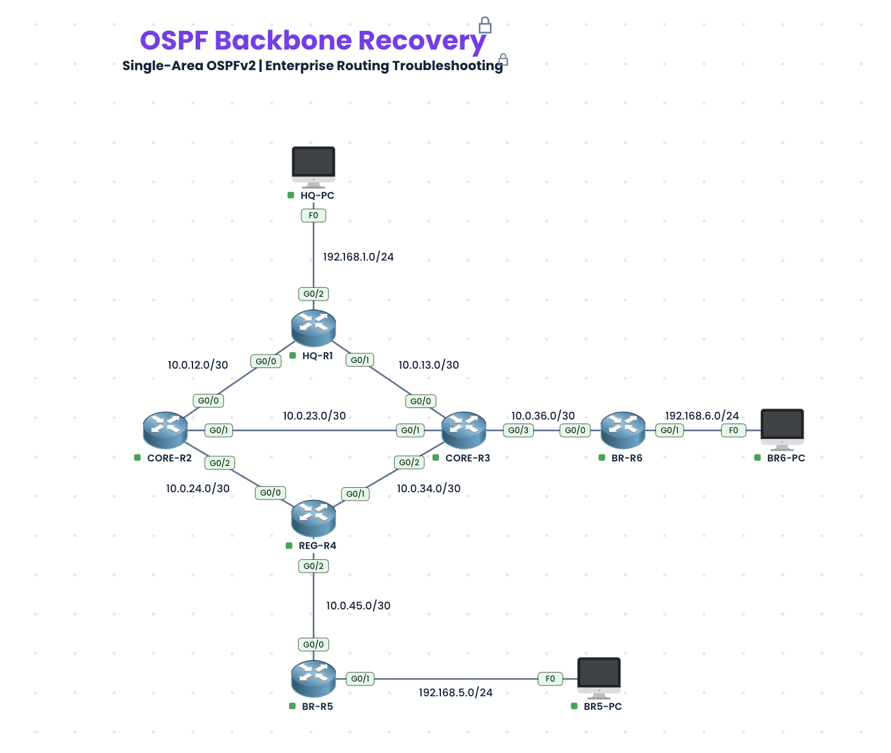

# OSPF Backbone Recovery

**Difficulty:** Intermediate–Advanced · **Estimated time:** 75–110 minutes  
**Topics:** Single-area OSPFv2, neighbor adjacencies, route advertisements, OSPF cost, troubleshooting  
**Environment:** [PingMyNetwork Sandbox](https://pingmynetwork.com/sandbox)

A router can have an active interface without a healthy routing relationship, and a network can remain reachable even while traffic follows the wrong path. In this lab, you'll investigate routing failures across a six-router enterprise backbone. The topology and IP addressing are provided; your job is to identify what changed, make targeted corrections, and verify the results.

> **Start here:** [Download the prepared OSPF lab](lab/ospf-backbone-recovery.json) and import it into [PingMyNetwork Sandbox](https://pingmynetwork.com/sandbox). The starter configuration contains intentional faults. Attempt the tasks before revealing the solution.

## Scenario

An organization connects its headquarters to two branches through a redundant OSPF backbone. Following planned maintenance, users at headquarters cannot reliably access branch resources, and network monitoring reports unexpected routing behavior between backbone routers.

All six routers should operate in **OSPF Area 0**. Several physical links remain active, so basic interface status alone won't explain the incidents. You've been assigned to diagnose the routing issues, restore the intended neighbor relationships and network advertisements, and confirm that traffic takes the expected path.

Make only the changes necessary to restore the design. Do not replace the network or configure another routing protocol.

## Objectives

By the end of this lab, you should be able to:

- Investigate OSPFv2 neighbor relationships on a multi-router, single-area topology.
- Distinguish directly connected reachability from OSPF-learned reachability.
- Identify why a connected LAN may be absent from other routers' routing tables.
- Analyze OSPF interface costs and identify unexpected next-hop selection.
- Restore required adjacencies, network advertisements, and the preferred backbone path.
- Verify repairs with relevant `show`, `ping`, and `traceroute` commands.

## Download and launch

1. [Download `ospf-backbone-recovery.json`](lab/ospf-backbone-recovery.json).
2. Open [PingMyNetwork Sandbox](https://pingmynetwork.com/sandbox).
3. Import the JSON file using the sandbox's import feature.
4. Examine the topology, review the addressing plan, and complete the troubleshooting tasks below.

**Format note:** The JSON file is a PingMyNetwork sandbox project, **not** a Cisco Packet Tracer `.pkt` or `.pka` file. It is intended for import into PingMyNetwork.

## Network topology



The backbone contains six routers, seven router-to-router links, and three directly attached PCs. All routers belong to OSPF Area 0. The diagram depicts the intended physical topology; it does not identify faulty configuration statements.

### Physical connections

| Device | Interface | Connected device | Interface |
|---|---|---|---|
| HQ-R1 | G0/0 | CORE-R2 | G0/0 |
| HQ-R1 | G0/1 | CORE-R3 | G0/0 |
| CORE-R2 | G0/1 | CORE-R3 | G0/1 |
| CORE-R2 | G0/2 | REG-R4 | G0/0 |
| CORE-R3 | G0/2 | REG-R4 | G0/1 |
| REG-R4 | G0/2 | BR-R5 | G0/0 |
| CORE-R3 | G0/3 | BR-R6 | G0/0 |
| HQ-R1 | G0/2 | HQ-PC | F0 |
| BR-R5 | G0/1 | BR5-PC | F0 |
| BR-R6 | G0/1 | BR6-PC | F0 |

## Addressing plan

### Backbone links

| Link | Subnet | Endpoint A | Endpoint B |
|---|---|---|---|
| HQ-R1 ↔ CORE-R2 | `10.0.12.0/30` | HQ-R1 G0/0: `10.0.12.1` | CORE-R2 G0/0: `10.0.12.2` |
| HQ-R1 ↔ CORE-R3 | `10.0.13.0/30` | HQ-R1 G0/1: `10.0.13.1` | CORE-R3 G0/0: `10.0.13.2` |
| CORE-R2 ↔ CORE-R3 | `10.0.23.0/30` | CORE-R2 G0/1: `10.0.23.1` | CORE-R3 G0/1: `10.0.23.2` |
| CORE-R2 ↔ REG-R4 | `10.0.24.0/30` | CORE-R2 G0/2: `10.0.24.1` | REG-R4 G0/0: `10.0.24.2` |
| CORE-R3 ↔ REG-R4 | `10.0.34.0/30` | CORE-R3 G0/2: `10.0.34.1` | REG-R4 G0/1: `10.0.34.2` |
| REG-R4 ↔ BR-R5 | `10.0.45.0/30` | REG-R4 G0/2: `10.0.45.1` | BR-R5 G0/0: `10.0.45.2` |
| CORE-R3 ↔ BR-R6 | `10.0.36.0/30` | CORE-R3 G0/3: `10.0.36.1` | BR-R6 G0/0: `10.0.36.2` |

All backbone links use subnet mask `255.255.255.252`.

### LANs and PCs

| PC | IP address | Subnet mask | Default gateway | Router LAN interface |
|---|---|---|---|---|
| HQ-PC | `192.168.1.10` | `255.255.255.0` | `192.168.1.1` | HQ-R1 G0/2 |
| BR5-PC | `192.168.5.10` | `255.255.255.0` | `192.168.5.1` | BR-R5 G0/1 |
| BR6-PC | `192.168.6.10` | `255.255.255.0` | `192.168.6.1` | BR-R6 G0/1 |

### Intended OSPF router IDs

| Router | Router ID |
|---|---|
| HQ-R1 | `1.1.1.1` |
| CORE-R2 | `2.2.2.2` |
| CORE-R3 | `3.3.3.3` |
| REG-R4 | `4.4.4.4` |
| BR-R5 | `5.5.5.5` |
| BR-R6 | `6.6.6.6` |

## Troubleshooting tasks

### Task 1 — Establish a baseline

Test each PC's default gateway, then attempt communication between the headquarters and both branch PCs. Inspect OSPF neighbor relationships and learned routes on the backbone routers. Record which destinations are reachable and where routing information is missing.

### Task 2 — Investigate the western branch outage

HQ-PC cannot reach BR5-PC even though the branch router's physical connection to the regional router is active. Identify why the western branch is not participating in the backbone as expected. Restore the required routing relationship without modifying the IP addressing.

### Task 3 — Investigate the eastern branch outage

The link between CORE-R3 and BR-R6 is operational and the routers can communicate across their shared subnet, but hosts elsewhere cannot reach BR6-PC. Determine whether the issue is with the OSPF adjacency, the branch LAN, or the routing information exchanged through the backbone. Restore remote access to the branch LAN.

### Task 4 — Examine backbone neighbor relationships

Inspect the routers forming the central backbone. Determine whether each expected OSPF neighbor relationship is present, including the direct connection between the two core routers. Correct any problem without disrupting the redundant paths.

### Task 5 — Restore the preferred route

After addressing reachability and adjacency issues, inspect how HQ-R1 reaches the regional segment `10.0.45.0/30`. The intended preferred path is **HQ-R1 → CORE-R2 → REG-R4**. If another path is selected, determine why and restore the intended routing decision while retaining the alternative path.

### Task 6 — Verify and explain

Repeat your original tests. For each fault, briefly document the symptom, investigation, root cause, correction, and verification evidence. Confirm that all three PCs can communicate and that all expected OSPF neighbor relationships have been restored.

## Verification

Useful commands on routers:

```cisco
show ip interface brief
show ip ospf neighbor
show ip ospf interface
show ip route
show ip route ospf
show running-config
```

For route selection and connectivity checks:

```cisco
show ip route 10.0.45.0
traceroute 10.0.45.1
ping 10.0.23.2
```

Use the commands where relevant rather than running every command on every device.

### Expected OSPF neighbors after repair

| Router | Expected neighbors | Router IDs |
|---|---:|---|
| HQ-R1 | 2 | 2.2.2.2, 3.3.3.3 |
| CORE-R2 | 3 | 1.1.1.1, 3.3.3.3, 4.4.4.4 |
| CORE-R3 | 4 | 1.1.1.1, 2.2.2.2, 4.4.4.4, 6.6.6.6 |
| REG-R4 | 3 | 2.2.2.2, 3.3.3.3, 5.5.5.5 |
| BR-R5 | 1 | 4.4.4.4 |
| BR-R6 | 1 | 3.3.3.3 |

All expected OSPF adjacencies should reach `FULL`. On OSPF point-to-point links, `FULL/-` is normal.

### End-to-end verification

| Source | Destination / command | Expected after repair |
|---|---|---|
| HQ-PC | `ping 192.168.1.1` | Success |
| HQ-PC | `ping 192.168.5.10` | Success |
| HQ-PC | `ping 192.168.6.10` | Success |
| BR5-PC | `ping 192.168.5.1` | Success |
| BR5-PC | `ping 192.168.1.10` | Success |
| BR5-PC | `ping 192.168.6.10` | Success |
| BR6-PC | `ping 192.168.6.1` | Success |
| BR6-PC | `ping 192.168.1.10` | Success |

On HQ-R1, `show ip route 10.0.45.0` should select next hop **`10.0.12.2` (CORE-R2)** after correction. Neighbor counts and end-to-end pings alone do not verify the preferred route, so check that separately.

If an initial ping fails but subsequent attempts succeed, repeat it to rule out ARP resolution or convergence timing.

---

## Walkthrough and solution

Spoilers ahead. Attempt the lab before expanding the solution.

<details>
<summary><strong>Reveal troubleshooting walkthrough and corrective commands</strong></summary>

### Incident 1 — Western branch loses its OSPF neighbor

**Symptom:** BR-R5 can reach REG-R4's directly connected address, but does not establish an OSPF adjacency, and remote networks cannot reach the BR5 LAN.

**Investigation — REG-R4:**

```cisco
show ip interface brief
show ip ospf neighbor
show running-config
```

**Evidence:** REG-R4's G0/2 is configured as a passive interface under OSPF process 1. The interface stays up, but OSPF Hellos are suppressed.

**Root cause:** A passive interface on the inter-router link prevents REG-R4 from forming an OSPF neighbor relationship with BR-R5.

**Correction — REG-R4:**

```cisco
configure terminal
router ospf 1
no passive-interface gigabitEthernet 0/2
end
```

**Why it works:** OSPF Hellos resume on the link. Verify that REG-R4 recognizes neighbor `5.5.5.5` in `FULL` state and that HQ-R1 learns `192.168.5.0/24`. Then ping BR5-PC from HQ-PC.

### Incident 2 — Eastern branch LAN is not advertised

**Symptom:** BR-R6 still forms an OSPF adjacency with CORE-R3, but the rest of the backbone cannot reach `192.168.6.0/24`.

**Investigation — BR-R6 and HQ-R1:**

```cisco
show ip ospf neighbor
show ip route connected
show running-config
```

On HQ-R1:

```cisco
show ip route 192.168.6.0
```

**Evidence:** BR-R6 has its LAN as a directly connected network, but the matching LAN `network` statement is missing from OSPF process 1.

**Root cause:** The OSPF adjacency is healthy, but the branch LAN is not included in the link-state advertisements.

**Correction — BR-R6:**

```cisco
configure terminal
router ospf 1
network 192.168.6.0 0.0.0.255 area 0
passive-interface gigabitEthernet 0/1
end
```

**Why it works:** OSPF advertises the branch LAN while the PC-facing interface remains passive. Confirm that HQ-R1 learns the OSPF route and that HQ-PC can ping BR6-PC.

### Incident 3 — Core-to-core OSPF adjacency is missing

**Symptom:** CORE-R2 and CORE-R3 can ping each other over `10.0.23.0/30`, but their direct OSPF neighbor relationship is absent.

**Investigation — CORE-R2 and CORE-R3:**

```cisco
show ip interface brief
show ip ospf neighbor
show running-config
```

**Evidence:** CORE-R2's G0/1 is configured as passive under OSPF process 1. CORE-R2 should have three OSPF neighbors, and CORE-R3 should have four.

**Root cause:** OSPF Hellos are disabled on an active backbone connection. Redundant routes can hide the adjacency failure from ordinary reachability tests.

**Correction — CORE-R2:**

```cisco
configure terminal
router ospf 1
no passive-interface gigabitEthernet 0/1
end
```

**Why it works:** The directly connected core routers can exchange OSPF Hellos and establish a `FULL` adjacency. Verify the neighbor counts again on both devices.

### Incident 4 — Traffic prefers an unexpected backbone path

**Symptom:** The region is reachable, but HQ-R1 selects CORE-R3 instead of CORE-R2 as the next hop for the regional network.

**Investigation — HQ-R1:**

```cisco
show ip route 10.0.45.0
traceroute 10.0.45.1
```

On CORE-R2:

```cisco
show ip ospf interface gigabitEthernet 0/2
show running-config
```

**Evidence:** CORE-R2's G0/2 uses an OSPF interface cost of `60`, rather than the intended `10`. From HQ-R1, the cost toward REG-R4 via CORE-R2 becomes `10 + 60 = 70`, while the alternative via CORE-R3 is `20 + 10 = 30` (before the cost of the destination network).

**Root cause:** An incorrect OSPF metric changes shortest-path selection without physically breaking the link.

**Correction — CORE-R2:**

```cisco
configure terminal
interface gigabitEthernet 0/2
ip ospf cost 10
end
```

**Why it works:** The path to REG-R4 through CORE-R2 becomes preferable again. On HQ-R1, `show ip route 10.0.45.0` should now identify next hop `10.0.12.2`.

### Final check

Run the neighbor and connectivity verification tables again. Also confirm that the preferred path to `10.0.45.0/30` is restored. If you'd like to preserve your corrected configuration, run this on each router:

```cisco
copy running-config startup-config
```

</details>

## Key takeaways

OSPF troubleshooting is about more than checking whether a link is up. A router may lose an adjacency because an interface is passive; another may have healthy neighbors but fail to advertise a LAN. And even when connectivity works, an incorrect OSPF cost can direct traffic over an unintended path. Isolate each symptom, verify the relevant neighbor and route information, apply the smallest correction, and test again.

## Resources

- [Practice in PingMyNetwork Sandbox](https://pingmynetwork.com/sandbox)

## License

Original documentation and accompanying files are made available under the repository's [MIT License](../../../LICENSE), except for any third-party material subject to its own terms.
