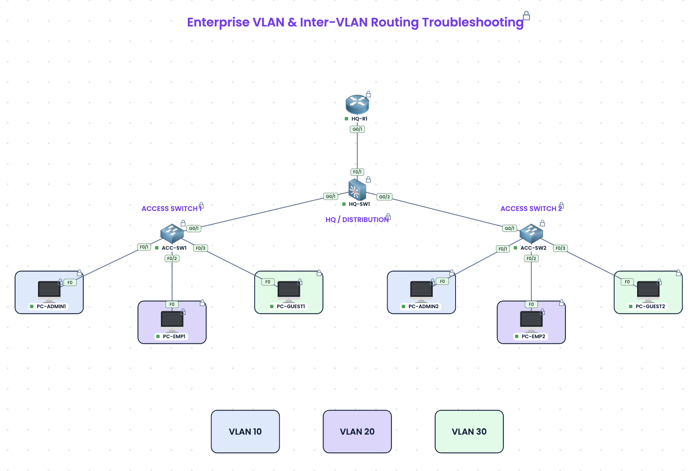

# Enterprise VLAN & Inter-VLAN Routing Troubleshooting

**Difficulty:** Intermediate · **Estimated time:** 45–75 minutes  
**Topics:** VLANs, 802.1Q trunks, router-on-a-stick, troubleshooting  
**Environment:** [PingMyNetwork Sandbox](https://pingmynetwork.com/sandbox)

A network can look perfectly connected while its users are unable to reach one another. In this lab, you'll investigate an enterprise network with three departments and restore connectivity following a maintenance window. The topology, IP addressing, and most of the configuration are already in place. Your job is to investigate what went wrong—not rebuild the network from scratch.

> **Start here:** [Download the prepared sandbox lab](lab/enterprise-vlan-troubleshooting.json) and import it into [PingMyNetwork Sandbox](https://pingmynetwork.com/sandbox). The starter network intentionally contains configuration faults. Try the tasks before opening the solution.

## Scenario

A company divides its headquarters into three logical networks:

- **Administration** — VLAN 10
- **Employees** — VLAN 20
- **Guests** — VLAN 30

Two access switches connect workstations in separate office areas to a central switch. A router-on-a-stick configuration provides connectivity between VLANs. After planned network maintenance, the help desk receives reports that some workstations cannot communicate with devices in their own department, and guest users cannot reach their gateway.

You are the network engineer assigned to diagnose the faults, make the smallest necessary corrections, and prove that connectivity has been restored.

## Objectives

By the end of the lab, you should be able to:

- Verify access-port VLAN membership and 802.1Q trunks.
- Distinguish Layer 2 connectivity failures from inter-VLAN routing problems.
- Examine router subinterfaces and VLAN encapsulation.
- Identify configuration faults using evidence from `show` commands and targeted pings.
- Correct each issue and verify the intended communication paths.

## Download and launch

1. Download **[enterprise-vlan-troubleshooting.json](lab/enterprise-vlan-troubleshooting.json)** using the link above (or the linked file in this repository).
2. Open [PingMyNetwork Sandbox](https://pingmynetwork.com/sandbox).
3. Use its import feature to open the JSON lab file.
4. Review the network and begin the tasks below. The device configurations are intentionally not fully functional.

**Format note:** This `.json` is a **PingMyNetwork sandbox export**, **not** a Cisco Packet Tracer `.pkt`/`.pka` file or a universal network-topology format. It is intended for the PingMyNetwork environment; do not try to open it directly in Packet Tracer.

## Network topology



The network has one router (**HQ-R1**), one central switch (**HQ-SW1**), two access switches (**ACC-SW1** and **ACC-SW2**), and six PCs. The colored PC groups represent their intended VLANs; they do not reveal the actual port configurations.

### Physical connections

| Device | Interface | Connected device | Interface |
|---|---|---|---|
| HQ-R1 | G0/1 | HQ-SW1 | F0/1 |
| HQ-SW1 | G0/1 | ACC-SW1 | G0/1 |
| HQ-SW1 | G0/2 | ACC-SW2 | G0/1 |
| ACC-SW1 | F0/1 | PC-ADMIN1 | F0 |
| ACC-SW1 | F0/2 | PC-EMP1 | F0 |
| ACC-SW1 | F0/3 | PC-GUEST1 | F0 |
| ACC-SW2 | F0/1 | PC-ADMIN2 | F0 |
| ACC-SW2 | F0/2 | PC-EMP2 | F0 |
| ACC-SW2 | F0/3 | PC-GUEST2 | F0 |

## Addressing plan

| VLAN | Department | Subnet | Default gateway |
|---|---|---|---|
| 10 | Administration | 192.168.10.0/24 | 192.168.10.1 |
| 20 | Employees | 192.168.20.0/24 | 192.168.20.1 |
| 30 | Guests | 192.168.30.0/24 | 192.168.30.1 |

| PC | IP address | Subnet mask | Gateway |
|---|---|---|---|
| PC-ADMIN1 | 192.168.10.11 | 255.255.255.0 | 192.168.10.1 |
| PC-ADMIN2 | 192.168.10.12 | 255.255.255.0 | 192.168.10.1 |
| PC-EMP1 | 192.168.20.11 | 255.255.255.0 | 192.168.20.1 |
| PC-EMP2 | 192.168.20.12 | 255.255.255.0 | 192.168.20.1 |
| PC-GUEST1 | 192.168.30.11 | 255.255.255.0 | 192.168.30.1 |
| PC-GUEST2 | 192.168.30.12 | 255.255.255.0 | 192.168.30.1 |

## Troubleshooting tasks

### Task 1 — Establish a baseline

From the PCs, test connectivity to their respective gateways and to the other PC in the same department. Then test communication between different VLANs. Record failures, and use the addressing plan and topology to narrow down where the problems might be.

### Task 2 — Investigate Administration connectivity

The help desk reports that **PC-ADMIN2** cannot reach its default gateway or communicate with **PC-ADMIN1**. Its intended IP information is shown above. Determine whether the fault is on the host, the switch port, or elsewhere in the network, and restore the correct connectivity.

### Task 3 — Investigate Employee connectivity

**PC-EMP1** can reach the Employee gateway, but **PC-EMP2** cannot. The two Employee workstations also cannot communicate. Investigate the path between the two access-switch areas and restore connectivity without disrupting other VLANs.

### Task 4 — Investigate Guest connectivity

The two Guest workstations can communicate within their VLAN, but neither can reach **192.168.30.1**. Follow the path toward the default gateway, identify the root cause, and fix it.

### Task 5 — Verify and explain

Repeat the failed tests after your corrections. Confirm that both same-VLAN and inter-VLAN connectivity work, and write a short explanation of **what failed, how you found it, and why the correction worked** for each incident.

## Verification

Useful commands on switches:

```text
show vlan brief
show interfaces trunk
show running-config
```

Useful commands on the router:

```text
show ip interface brief
show ip route
show interfaces gigabitEthernet 0/1.30
show running-config
```

Useful PC tests (run on the specified source device):

| Source | Destination / command | Expected after repair |
|---|---|---|
| PC-ADMIN1 | `ping 192.168.10.12` | Success |
| PC-ADMIN2 | `ping 192.168.10.1` | Success |
| PC-EMP1 | `ping 192.168.20.12` | Success |
| PC-EMP2 | `ping 192.168.20.1` | Success |
| PC-GUEST1 | `ping 192.168.30.12` | Success |
| PC-GUEST1 | `ping 192.168.30.1` | Success |
| PC-GUEST2 | `ping 192.168.30.1` | Success |
| PC-ADMIN1 | `ping 192.168.20.11` | Success |
| PC-ADMIN1 | `ping 192.168.30.11` | Success |

A successful repair should restore the required connectivity without changing the assigned subnets, host addresses, or intended network design. If the first ping fails while later attempts succeed, repeat the test to account for initial ARP resolution.

---

## Walkthrough and solution

**Spoilers ahead.** Attempt the lab before expanding the sections below.

<details>
<summary><strong>Reveal troubleshooting walkthrough and corrective commands</strong></summary>

### Incident 1 — PC-ADMIN2 cannot access the Administration VLAN

**Symptom:** PC-ADMIN2 cannot reach PC-ADMIN1 or its default gateway, even though its IP configuration belongs to `192.168.10.0/24`.

**Investigation:** Start on ACC-SW2 and check access-port membership:

```text
show vlan brief
```

**Evidence:** The saved starter configuration assigns **ACC-SW2 F0/1** to VLAN **20**, alongside the Employee port F0/2. However, PC-ADMIN2 should be in VLAN **10**.

**Root cause:** Incorrect access VLAN assignment. The PC is connected to the wrong Layer 2 broadcast domain.

**Correction — ACC-SW2:**

```cisco
configure terminal
interface fastEthernet 0/1
switchport access vlan 10
end
```

**Why:** This restores VLAN 10 membership without changing PC-ADMIN2's IP address. Verify with `show vlan brief`, then ping `192.168.10.1` from PC-ADMIN2 and `192.168.10.12` from PC-ADMIN1.

### Incident 2 — Employee traffic fails across the access-switch uplink

**Symptom:** PC-EMP1 can reach `192.168.20.1`, but PC-EMP2 cannot reach the gateway or PC-EMP1.

**Investigation:** Review the uplink between HQ-SW1 and ACC-SW2:

```text
show interfaces trunk
```

**Evidence:** On **HQ-SW1 G0/2**, the allowed VLAN list is `10,30`. VLAN 20 is missing. ACC-SW2's uplink itself allows `10,20,30`, so the restriction is on the central-switch side.

**Root cause:** An incomplete 802.1Q allowed-VLAN list on the trunk prevents Employee VLAN traffic from traversing the link.

**Correction — HQ-SW1:**

```cisco
configure terminal
interface gigabitEthernet 0/2
switchport trunk allowed vlan 10,20,30
end
```

**Why:** VLAN 20 is now permitted across the link to ACC-SW2. Verify the allowed and active VLANs using `show interfaces trunk`, then retest connectivity from PC-EMP2 to its gateway and from PC-EMP1 to PC-EMP2.

### Incident 3 — Guest PCs cannot reach their gateway

**Symptom:** PC-GUEST1 and PC-GUEST2 can reach each other in VLAN 30, but neither can reach `192.168.30.1`.

**Investigation:** Since the Guest VLAN is working across the switches, inspect HQ-R1's router-on-a-stick subinterface:

```text
show interfaces gigabitEthernet 0/1.30
show running-config
```

**Evidence:** The router has IP address `192.168.30.1/24` on `GigabitEthernet0/1.30`, but its encapsulation is configured as **802.1Q VLAN 99**, not VLAN 30. The subinterface can still display `up/up`; that alone does not prove the VLAN tag is correct.

**Root cause:** Incorrect 802.1Q encapsulation tag on the Guest gateway subinterface.

**Correction — HQ-R1:**

```cisco
configure terminal
interface gigabitEthernet 0/1.30
encapsulation dot1Q 30
end
```

**Why:** The router now associates the Guest gateway IP with VLAN 30 frames. Verify the encapsulation on the interface, then ping `192.168.30.1` from both Guest PCs.

### Final check

After applying the corrections, repeat the tests in the verification table. Save your completed device configurations if you want to preserve your solution:

```text
copy running-config startup-config
```

### What the faults teach

- Correct IP settings cannot compensate for an incorrectly assigned access VLAN.
- Trunk links can be operational while silently excluding one necessary VLAN.
- Router subinterfaces can appear operational even when the 802.1Q encapsulation tag is wrong.
- Targeted pings and a small number of relevant `show` commands are usually more useful than changing many settings at once.

</details>

## Key takeaways

Troubleshooting works best when you narrow the scope of the fault using evidence. Start with connectivity symptoms, confirm VLAN membership and trunk forwarding, inspect the relevant gateway, then make the smallest change that addresses the root cause. Finally, repeat the original tests to show the failure has been resolved.

## Resources

- [Practice in PingMyNetwork Sandbox](https://pingmynetwork.com/sandbox)
- [Router-on-a-Stick configuration reference](https://pingmynetwork.com/network/ccna-200-301/router-on-a-stick-configuration)

## License

The original documentation and accompanying files in this repository are provided under the repository's [MIT License](../../../LICENSE), except for any third-party materials subject to their own terms.
